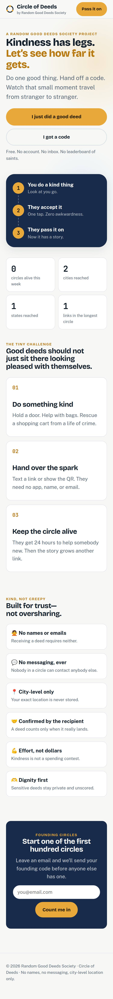
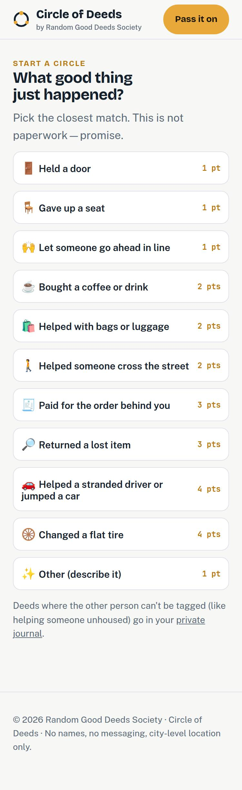
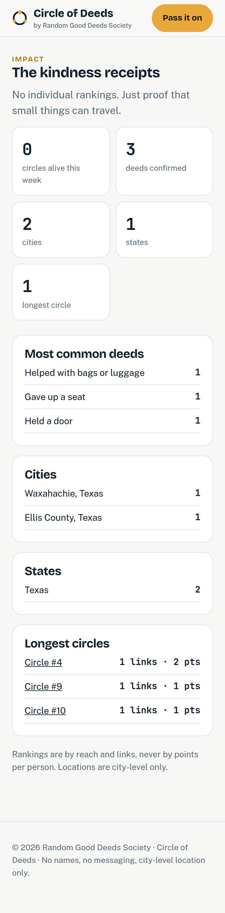
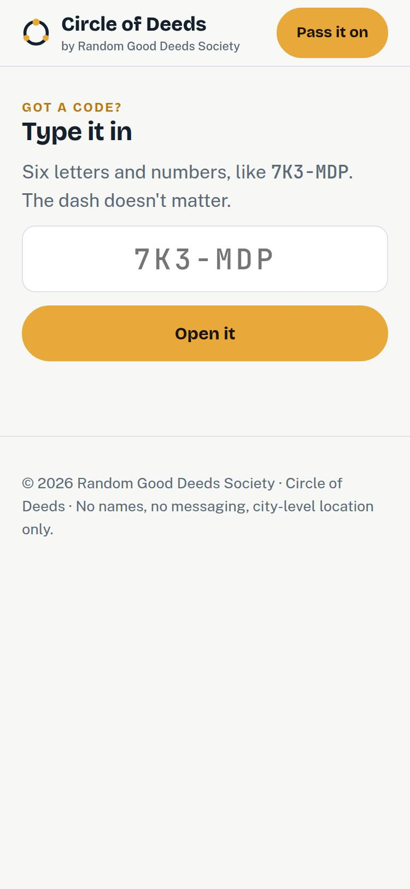
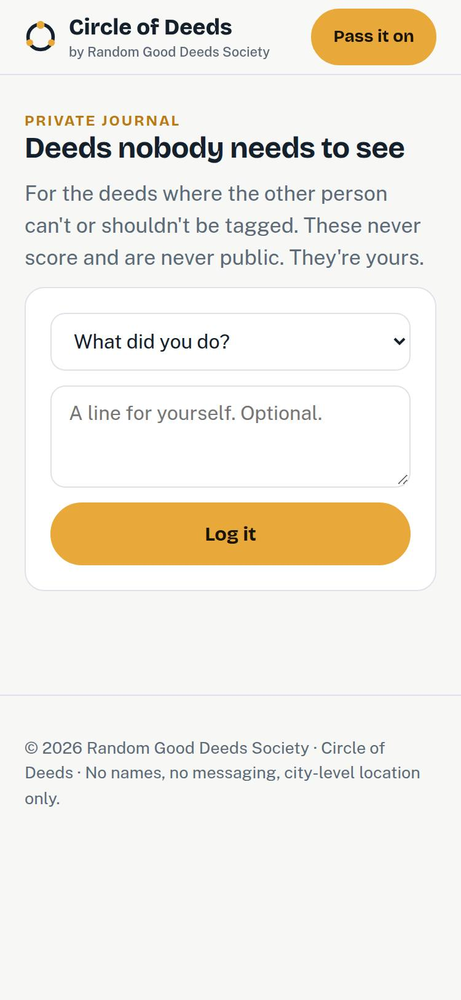
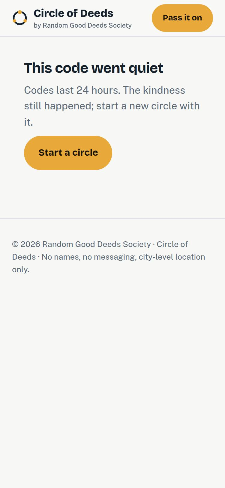
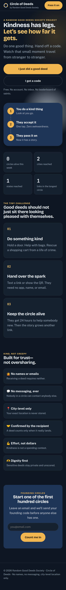
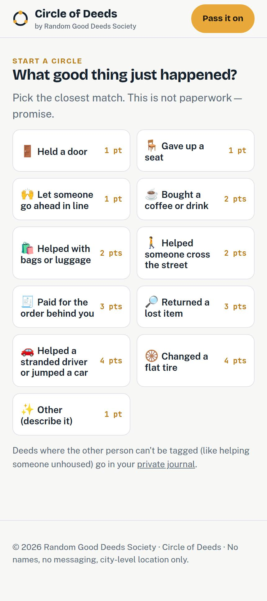
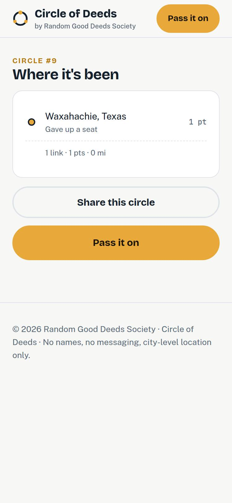

# Mobile audit, Oct 18, 2026

Read-only review of https://circleofdeeds.app and of the current `main` code. No app code was changed.

Viewed in desktop Chrome with a phone viewport, touch enabled, at **375px** and **414px** wide (and once at 430px, where the deed list switches to two columns). Pages: home, give (`/start`), enter a code (`/d`), an expired code, an already-accepted code, circle 9, journal, and impact. Dark mode was checked on the homepage at 375px.

Creating a code or accepting one would write production data, so those two screens were not clicked through. The QR handoff, the accept form, the countdown, and the "Pick an easy win" card were reviewed from `app/start/page.js`, `app/d/[code]/page.js`, and `components/ContinuationCard.js`. This was not a physical iPhone, so the iOS keyboard and the calendar download were not confirmed on a device.

Neither 375 nor 414 shows a horizontal scrollbar. Text does not run off the screen. Deed buttons are one column at both widths and are about 51px tall, which is a comfortable tap. The layout break is navigation, not width.

## Findings

### 1. High — every page — phone header hides most of the site

At 640px and below, `nav.top` is `display: none` (`app/globals.css`). Nothing replaces it. At 375 and 414 the sticky bar is only the logo and a "Pass it on" button.

- **Impact** is linked only from that hidden nav. A phone cannot open it.
- **Journal** is linked only from a sentence at the bottom of `/start`, plus the hidden nav.
- **Got a code?** is a homepage button, not a header item. From give, journal, impact, or a circle, the header cannot take you there.

The logo row itself fits. It does not overlap the button.

**Suggested fix:** a bottom bar or a menu button with Pass it on, Got a code, Impact, and Journal. Make each target at least 44px tall.

### 2. Medium — impact — circle links are too small to tap

On `/impact`, "Circle #4", "Circle #9", and "Circle #10" measure about **23px tall** (150px wide at 375, 189px wide at 414). The row is the link, and the row is only the text line.

**Suggested fix:** make the whole rank row a link and pad it to at least 44px.

### 3. Medium — enter a code — a short code fails with no message

`/d` only navigates when the typed code is exactly 6 letters or numbers. Anything else does nothing: the button stays active and no error appears (`app/d/page.js`).

**Suggested fix:** disable "Open it" until there are 6 characters, or say "Codes are 6 characters."

The field itself is in good shape for a phone: 26px type, `autoCapitalize="characters"`, and an accessible name.

### 4. Medium — receive and journal — two fields are unlabeled

- On the accept screen, the city box has a visual label, but the `<label>` is not tied to the input (no `for` / `id`). Reviewed from code. The live accept form was not opened, because every public code is already expired or accepted.
- On `/journal`, the note box has a placeholder and no label. The deed menu does have an accessible name. Measured on the live page.

**Suggested fix:** connect the city label to the input, and give the note box an `aria-label` such as "Note for yourself".

### 5. Medium — give and receive — the calendar file may not save on an iPhone

"Add a calendar nudge" builds an `.ics` blob and clicks a temporary link with the `download` attribute (`components/ContinuationCard.js`). Mobile Safari often ignores that and opens the file or does nothing. This is the Oct 14 reminder, and it is the path a recipient is asked to use on their phone. Not confirmed on a device.

**Suggested fix:** offer the file through the share sheet when `navigator.share` can take a file, and test the download on an iPhone before relying on it.

The rest of that screen is sized for a thumb: the accept button and the "pass the spark" button are full width with large type. The countdown is 52px monospace and fits a 375px column. "Find it" beside the city field measured about 68 by 58px in the live stylesheet, so that control is big enough, and the row does not overflow at 375.

### 6. Medium — give, receive, circle, journal — content waits on JavaScript

The homepage is server-rendered. From this network, DOMContentLoaded was about 270ms and the first load transferred about 200KB.

Give, receive, circle, and journal are client pages. Until JavaScript runs and Supabase answers, the useful part of the page is "Opening your deed…" or "Loading…". Supabase responses here were roughly 30–200ms, on top of the script download. A phone on a slow connection will sit on that empty state longer.

There is also a **404 for `/favicon.ico`**, and `public/manifest.json` has `"icons": []`, so Add to Home Screen has no icon. The font stylesheet preconnects to `fonts.googleapis.com` but not to `fonts.gstatic.com`, which is where the font files actually come from.

**Suggested fix:** server-render the deed list and the code lookup, or show a skeleton that matches the final layout. Add a favicon and a manifest icon. Preconnect to `fonts.gstatic.com`.

Expired and already-used codes do render clear next steps once the request returns.

### 7. Low — light mode — small gold labels fail contrast

"Gold deep" `#B97A12` on the page background `#F7F8F6` is about **3.4:1**. On the gold-tinted notice (`#FBEFD7`) it is about **3.2:1**. Normal text needs 4.5:1. This is the 12px eyebrows ("A Random Good Deeds Society project", "Start a circle") and the gold handoff banner on the give page.

Muted body text `#5C6A78` on the page is about 5.2:1, which passes. The gold and navy buttons pass. Dark mode passes: muted text is about 7.6:1 and the gold eyebrow about 11.5:1.

**Suggested fix:** darken the eyebrow and the gold-on-gold notice text in light mode.

### 8. Low — several controls — focus and a few short targets

- Visible focus styling exists on `.btn` only. Deed tiles, text links, and inputs do not get a focus ring.
- The logo's hit area is 43px tall, just under the 44px guide. The line "by Random Good Deeds Society" is 11px.
- The "private journal" sentence on `/start` measures 38px tall.

**Suggested fix:** use the same focus ring on tiles, links, and fields. Bump the logo lockup and the journal link so the tap height clears 44px.

## What held up

- No horizontal overflow at 375 or 414 on the eight screens above.
- Primary buttons (start a deed, enter a code, deed tiles, "Count me in", "Log it") are at least 46px tall and full width when they are the main action.
- Form text is 16px or larger, so iOS will not zoom the page on focus.
- At 430px the deed list becomes two columns (`max-width: 420px` is the one-column break). Tiles are 190px wide, long names wrap, and the page still does not scroll sideways. 414px stays one column, which is the more comfortable of the two.

